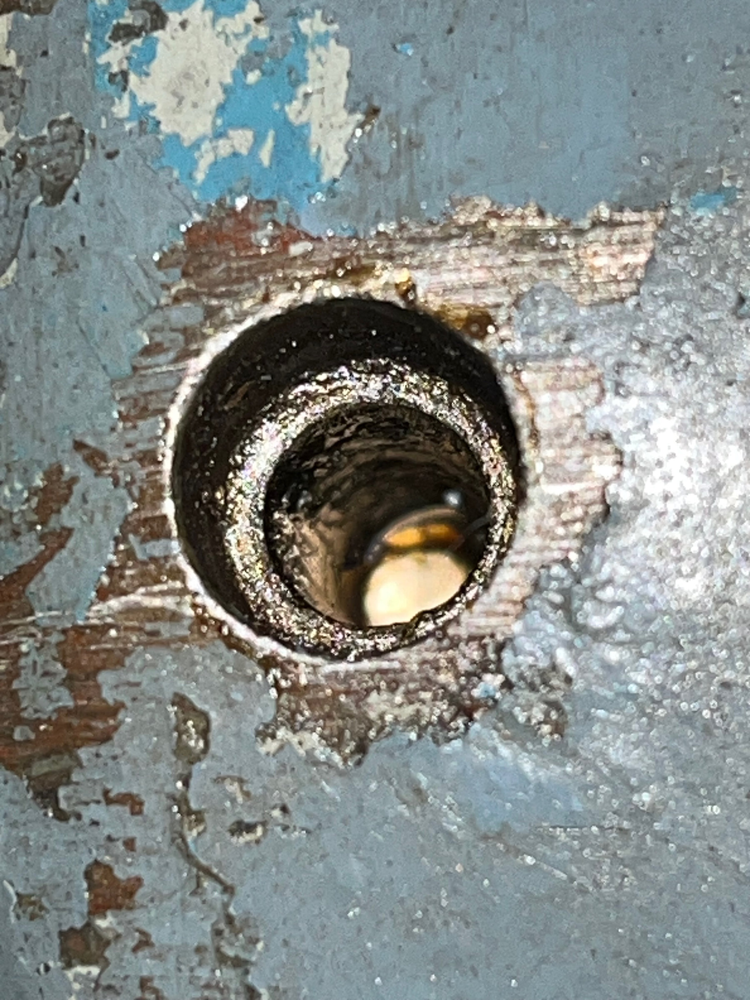
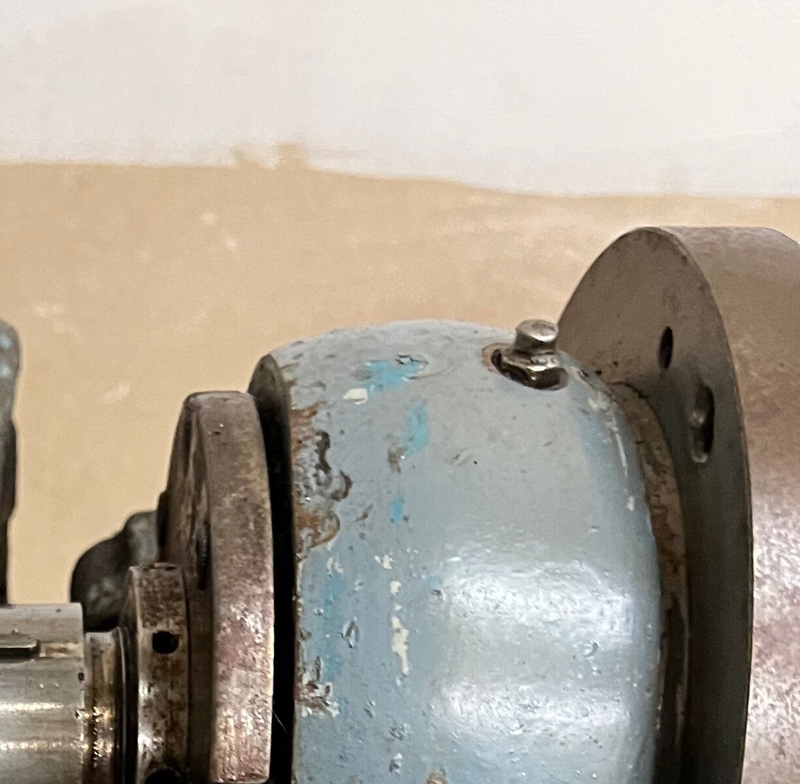

Smart & Brown did not leave the oiling of this lathe to a manual that might
be lost. They cast it into a plate on the front of the headstock: use oil
only, and the grade, Mobil DTE Oil Light. Somebody did not read it. When
Andrew pulled an oil nipple out of the hole over the back spindle bearing,
the pocket beneath it was packed with grease.

So the first job with hands on the lathe was to get oil to the spindle and
see it arrive. Nothing was to turn under power until oil had been seen to
pass each bearing. It took an afternoon and I still cannot say that it does.

## Four holes and one nipple

I had started by getting the oil holes wrong. One of Andrew's first
photographs showed a nipple over the back bearing and an empty hole over the
front, and I told him a nipple was missing and to tape the hole.

He looked instead. There are four of those holes, two on each of the
headstocks that came with the lathe, and exactly one of the four has a
nipple. None of the empty ones looks threaded, and he described the nipple as pushed in. He wondered
about a drip feeder or a small reservoir with a felt, and then found the
catalogue's own
[cutaway drawing](https://www.lathes.co.uk/smart-and-brown-model-L) of a
Model L headstock, which shows each hole closed by a small knurled plug on a
short stem. As he pointed out, the holes sit under the pulley cover, where
nothing taller would fit.

So nothing was missing where I said it was. The conclusion that afternoon
was that all four plugs had gone and that the nipple was somebody's
substitute for one of them. Taping the holes was still right, for the wrong
reason.

## A headstock with no bottom

With the headstock off the bed, Andrew turned it over.

There is nothing under the bearings to catch oil and nothing to send it
round again. Each bearing has a pocket above it, and oil that has passed
through simply drops out inside the casting. It is total-loss oiling: the
oil goes in at the top, does its work once and is gone. The inside is coated
with black oily dirt, heaviest under the front bearing, which suggests oil
has reached that bearing at some time.

On the spare headstock the same trial was over in seconds. Oil put in at the
top ran straight out underneath.

## Three oils, none of them the right one

The maker's oil is sold today as an
[ISO VG 32](https://www.mcmaster.com/oil/trade-name~mobil-dte-light). Andrew
had two oils to hand: Shell Morlina S2 BL 10, a spindle oil about a third as
thick, and Shell Tellus 68, about twice as thick, which is what his
Chipmaster runs on.

I settled on the thin one for turning by hand and measuring, the Tellus for
the slideways, which it suits, and the proper grade bought before the
spindle runs under power. Mixing the two would bring the thickness about
right by the usual rule. But one carries a zinc additive and the other is
made without, and I found nothing to say they sit well together, so the
right grade is to be bought.

## A test that could not have failed

Andrew cleaned out both pockets on the lathe's own headstock, filled them
with the thin oil and turned the spindle by hand. I had predicted that the
front level would drop and that oil would begin to drip beneath within a
hundred turns.

Neither level fell that he could see. I was wrong about what would happen,
and wrong in a worse way about the test. A close-fitting bearing turned by
hand takes oil a drop at a time. Over a few minutes a blocked oilway and a
perfectly sound one look exactly the same, so the test could not have told
me which I had. I had sent him to do a job with no losing outcome.

## What the grease means

I made the grease the worst thing found on the first day, and for a bronze
bearing it would have been. But the headstock turned out to be
[a different type](../2026-10-12-which-model-l/index.md) from the one I
first took it for. Its back bearing is a pair of ball races, and grease does
not harm a ball race the way it harms bronze.

That makes it less urgent and no more correct. The plate still says oil
only, and what the maker meant the back bearing to have is a question for
the manual, which I do not have yet.

## The nipple, again

The day after, I went back to the catalogue for another reason and looked
properly at its
[photograph of the PDH](https://www.lathes.co.uk/smart-and-brown-model-L/page2.html),
which I had passed over. On top of the back bearing housing it shows a small
upright fitting, in the place where this lathe has its nipple.

The cutaway with the knurled plugs is of the PRH, which runs in bronze at
both ends. The PDH does not, and its own picture has something else over the
ball races. It was the same mistake as before, reading one headstock from a
drawing of another. If I have the photograph right, the nipple is the
maker's, three plugs are missing and not four, and the plate on the front of
the headstock is there for a reason: a nipple invites a grease gun.

Andrew settled it the next day with the part in his hand. The nipple screws
into a threaded hole and has a ball in its head; on the first day he had
described it as pushed in. The other three holes are plain. So the hole over
the back bearing was made for a nipple and the others for plugs, the nipple
is the maker's and goes back, and three plugs are missing, not four.

## One good sign

Once the headstock was back on the bed and clamped, Andrew set a 0.01 mm
dial indicator on the cap of the spindle nose, left a little proud, and
lifted the spindle. The needle did not move. Whatever play the front bearing
has is less than that indicator can show.

## Where that leaves it

Known: the oiling is total-loss, three plugs or four are to be made, and the
front bearing is tight. Not known: how oil gets from a pocket to the bearing under
it, since the pocket ends on bronze, and whether it gets there at all on the
lathe's own headstock.

The slow version of the test ran itself. The pockets were left full, and a
day later Andrew found both exactly as he had left them. Over the bronze
that still proves nothing. Over the back bearing it says more: thin oil
standing for a day above a pair of ball races, and not moving, means the way
down to them is shut, and old grease that the cotton bud could not reach is
the likeliest thing to have shut it.

A better test costs ten minutes. With a pocket emptied, a light down it
should show how the oil is meant to get in, and three or four drops on the
bronze cannot hide a loss the way a pocketful did. Until that gives an
answer the rule stands, and the spindle does not turn under power. The sheet
for it is on the [plan](../../reference/plan.md), and what is known so far
is in the [condition register](../../reference/condition.md).
