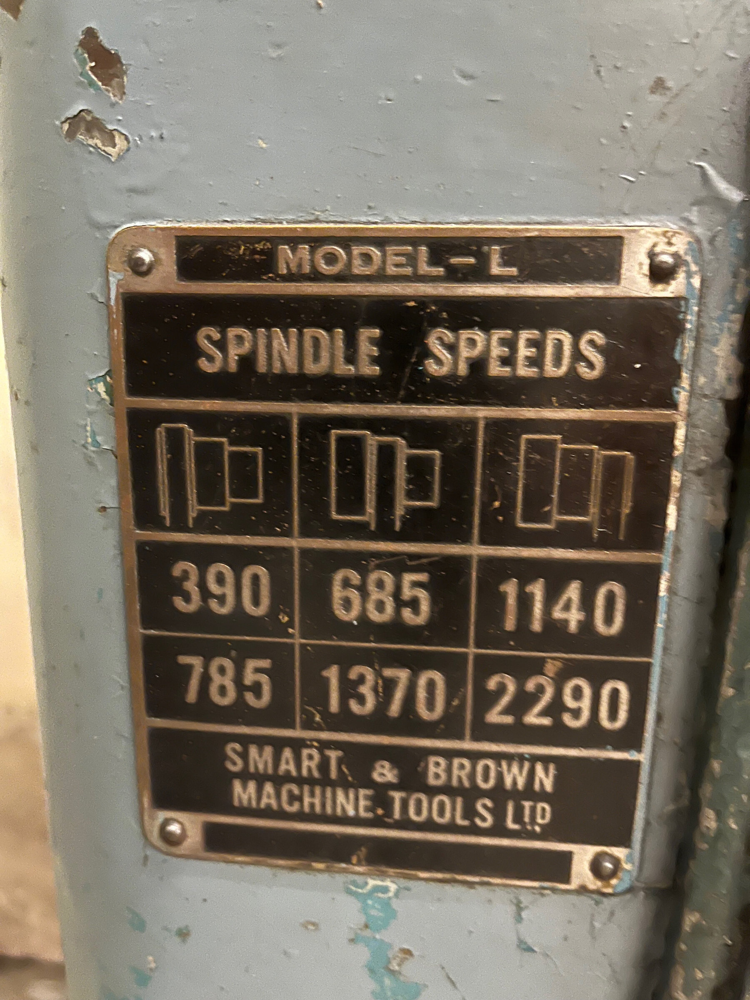
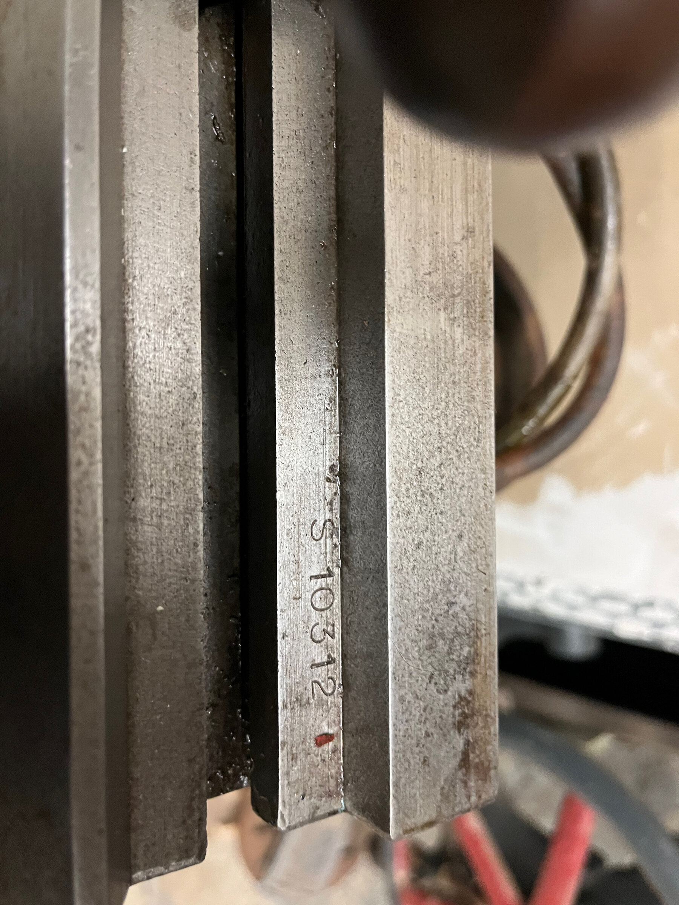
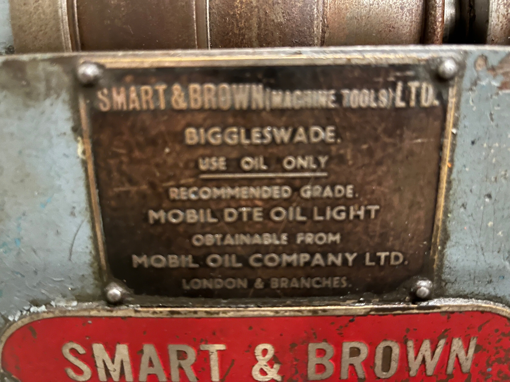
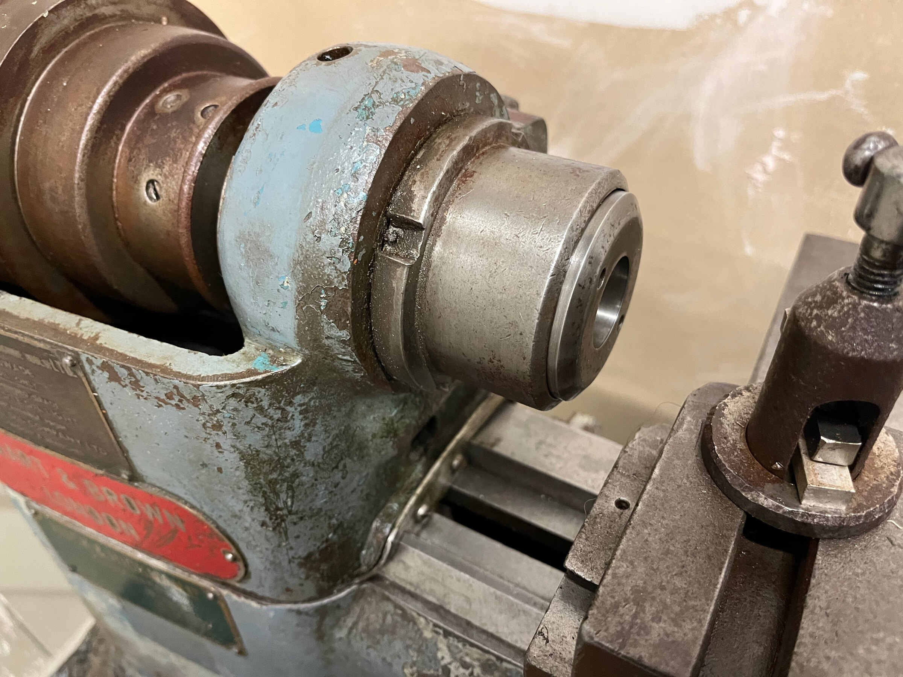
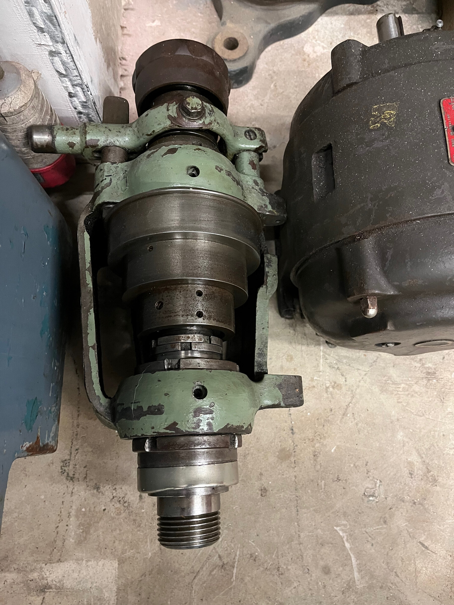
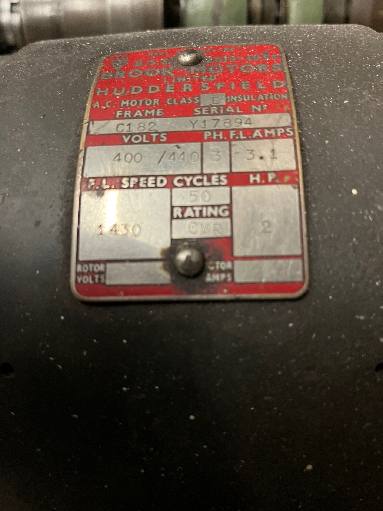

I needed to know which Model L this is before asking Andrew to move anything
on it. They were sold with half a dozen headstocks, some on bronze bearings
and some on ball races, and I could not say how to oil a spindle I could not
name. So I asked him questions, four at a time, and he answered some in words
and some with photographs. Nothing was taken apart.





The plates gave more than the name. It is a Model L, serial number S10312,
which by the few dated numbers on record puts it at
[about 1960](../../reference/identification.md). It was sold through Buck &
Hickman. The maker's oil is there in cast letters, Mobil DTE Oil Light, with
the words "use oil only" over it. And the speed plate has two rows of three
speeds, the lower exactly double the upper, which means a three-step pulley
and a motor with two speeds.

The headstock took three goes. From this photograph and the next I read a
lever-operated collet closer, which was right, and then two things that were
not.

I took the cap for a nosepiece for dead-length collets, which would have made
this a different headstock with different bearings. And because one
photograph showed an oil nipple over the back bearing and an empty hole over
the front, I told Andrew a nipple was missing and to tape the hole.

His photograph of the spare headstock settled the first. Under a cap like
that is an ordinary coarse thread for a chuck. He settled the second by
looking: there are four of those holes, two on each headstock, only one has a
nipple, and none of the other three is threaded. Then he found the
catalogue's own cutaway drawing of this headstock, which shows each hole
closed by a small knurled plug, and pointed out that they sit under the
pulley cover where nothing taller would fit. So all four plugs are missing
and the nipple is somebody's substitute. Taping the holes was still the right
thing to do, for the wrong reason.

The cutaway matches this machine's closer part for part, and on that I am
calling both headstocks the catalogue's Type PRH: a hardened spindle in two
adjustable bronze bearings, with the pulley on ball races of its own.

The drive is where the lathe is furthest from working. The two switches on
the stand are labelled Reversing Switch and Change Pole Switch, so it was
built for a motor with two speeds, as the speed plate says. The motor that
came with it has one. It was loose when Andrew got the lathe, it is on the
floor now, and there is no belt. Inside the stand there is a platform for a
motor, with a lever to slacken the belt for changing steps, and Andrew has
two stepped pulleys. His inverter gives up to 415 V three-phase from a
single-phase supply, which is what this motor wants.

The lathe carries parts of two machines. Its headstock and stand are
grey-blue over an older turquoise. The tailstock on the bed is green, like
the spare headstock. A second tailstock, the one that sets over, lies in the
tray with most of its paint gone. With all that came a three-jaw chuck and a
backplate for it that is threaded for the nose and otherwise unmachined. No
collets came at all, which for a headstock built round a collet closer is
the largest thing missing. There is a pipe for coolant, and the tray is a
proper basin with a brass drain plug; Andrew wants the coolant working again
in the end.

His own reading is the most encouraging thing in all this. Everything he has
turned by hand feels, in his words, buttery smooth, and nothing he has seen
looks terrible.

Of what I had predicted: a Model L, right. A collet closer on the left-hand
end of the spindle, right. A motor plate with one voltage and two speeds,
half right, since the two speeds turned out to be on the lathe's switch and
not on this motor. A missing nipple and a dead-length nose, both wrong, and
both put right by Andrew looking at the thing itself.

Three decisions. The spare headstock and the set-over tailstock are parked,
oiled and covered, until the lathe is done. The chuck's backplate will be
machined on this lathe's own spindle once it runs, which makes it the
lathe's first job. And I am going on to the survey without the maker's
manual, which I had said I would not do. The machine names its own oil and
the cutaway shows how the bearings are arranged, and that is enough to oil
and measure it. It is not enough to take a headstock apart, and I will want
the manual before that.
