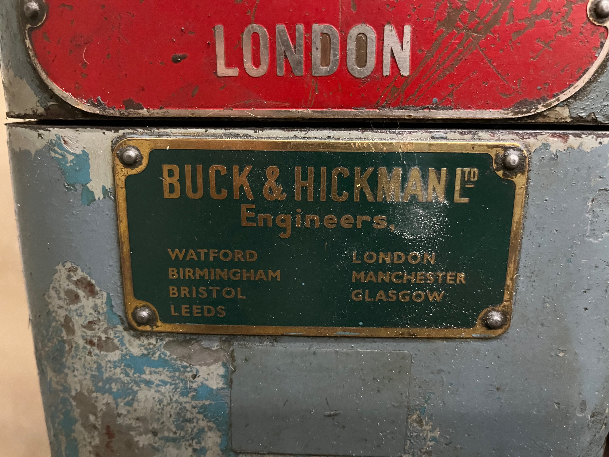
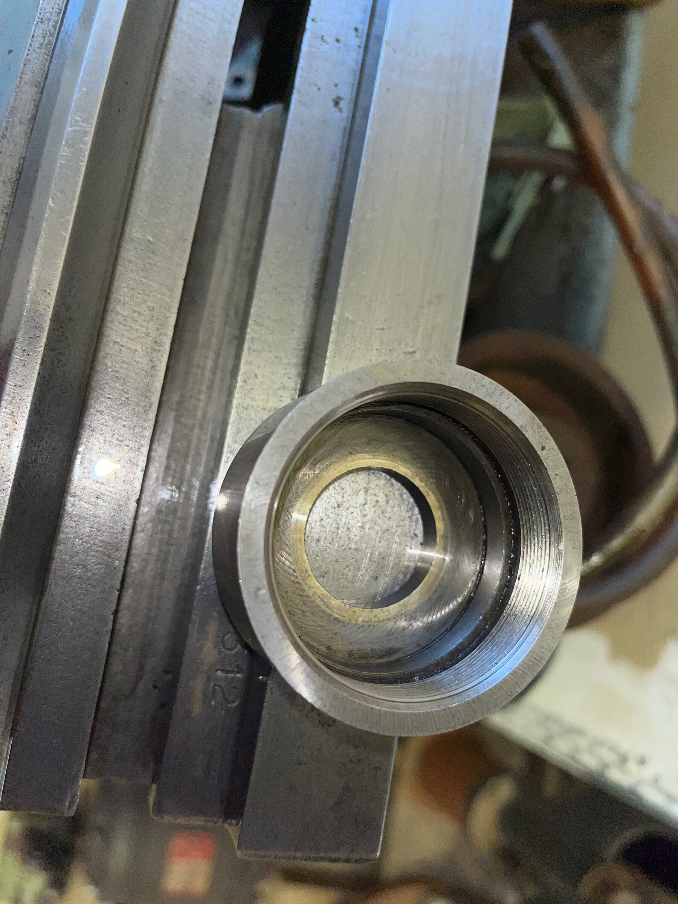
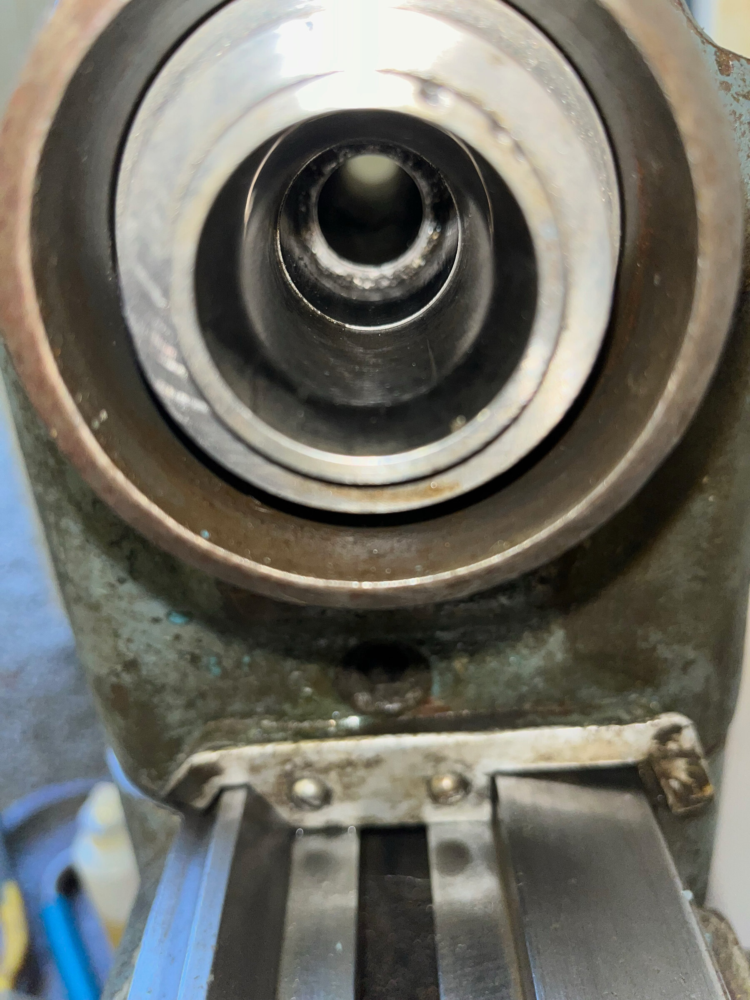

"A Smart & Brown lathe" does not say much. The firm, at Biggleswade in
Bedfordshire, built lathes from the early 1940s into the 1990s, and they
[have little in common](https://www.lathes.co.uk/smartbrown) beyond the name
and the class of work they were meant for. One was a copy of the 9-inch South
Bend. One had a camlock nose and push-button speeds. The
[Model L](https://www.lathes.co.uk/smart-and-brown-model-L) was neither: a
small plain-turning lathe after a pre-war Boley, with no leadscrew and no
screwcutting, made for the whole of that time.

Even "a Model L" is not enough. It was sold with a choice of half a dozen
headstocks, some running in bronze and some on ball races, some taking a
chuck and some not. Which one a lathe has decides how its spindle is oiled,
what fits its nose and which pages of the manual apply. I could not ask
Andrew to oil a spindle I could not name, so naming it came first, and
nothing was taken apart to do it.

## What the plates say





The plates gave the name at once: MODEL-L, on the speed plate. Andrew found
the number, S10312, stamped into the top of the bed at the tailstock end. It
was sold through Buck & Hickman, whose plate lists seven branches.

The number gives a date, of a sort. Smart & Brown are
[said to have numbered](https://www.lathes.co.uk/sabel) every machine in one
sequence as it left the works, whatever the model, and a few survivors are
dated: 8385 from 1955, 9562 from 1958. That is a little under four hundred
machines a year, and at that rate 10312 left about two years after 9562. So
about 1960, resting on three things I cannot check: that every model shared
the sequence, that the rate held, and that the S in front of this number
does not mean another series altogether.

The speed plate says more than its speeds. The lower row is exactly double
the upper, which means a three-step pulley and a motor with two speeds. The
two rotary switches on the stand agree. One is labelled Reversing Switch,
and the other Change Pole Switch, with low, off and high.

## A motor it was not built for

The motor that came with the lathe has one speed. At 1,430 r.p.m. it would
give the lower row of the plate and nothing would give the upper. So either
the lathe's own motor was replaced or this one never belonged to it. It was
loose when Andrew got the lathe and there is no belt. Inside the stand there
is a platform for a motor, with a lever to slacken the belt for changing
steps, and he has two stepped pulleys.

The drive is where the lathe is furthest from working, and also where it is
luckiest. Andrew's workshop is single-phase, with an inverter that gives up
to 415 V three-phase, which is what this motor wants. My intention is to
keep both of the lathe's switches doing their old jobs as signals to the
inverter: forward and reverse from one, and two set frequencies from the
other, which would give back both rows of the plate from a motor with one
speed. That is to be settled when the electrics are.

## Two machines in one photograph

The paint tells the next part. The headstock and the stand are a grey-blue
over an older turquoise. The tailstock on the bed is green, and so is a
second headstock. A second tailstock, the kind that sets over, has a
brighter green over red. With them came a three-jaw chuck and a backplate,
threaded and otherwise unmachined.

It came to Andrew in pieces, from a deceased estate by way of an owner who
meant to get it running and never did, and who had gathered the second
headstock and tailstock along the way. So this is one lathe wearing parts of
at least one other, and every part has to be named for itself. I learned
that the slow way.

## Three goes at the headstock

From Andrew's first two photographs of the headstock I read a lever-operated
collet closer at the back, and at the front a capped nose of the kind that
takes dead-length collets and nothing else. In the catalogue that is the
Type PDH: bronze at the front, a pair of preloaded ball races at the back,
and no thread for a chuck.

Then he sent the spare.

It has a bare nose with an ordinary coarse thread for a chuck. Andrew found
the catalogue's cutaway drawing of the Type PRH, a headstock with a threaded
nose, two bronze bearings and a lever closer, and the spare matches it in
everything he can see. I decided the cap on the lathe's own nose was a cover
over the same thread, called both headstocks PRH, and wrote that my first
reading had been wrong. That stood for most of a day.

Andrew ended it by trying to work out how the chuck's backplate would go on
the lathe's own nose. It cannot.





Under the cap there is only a fine thread, for the cap itself. The first
reading was the right one, and the spare had told me nothing about it,
because the spare is from another machine. Evidence about a part comes from
that part.

One oddity is left. The catalogue says the plain PDH has no drawbar, and the
cap alone closes its collets. This one has a lever closer on the back of the
spindle as well, which Andrew called confusing, and it is. The same pages
list a lever closer made for dead-length collets, and a headstock called the
LPH whose single lever works a brake and a clutch along with the collet. So
it is a PDH with that closer, or an LPH, and I do not yet know which. The
bearings and the nose are the same either way.

## What it adds up to

A Smart & Brown Model L, serial number S10312, of about 1960, sold through
Buck & Hickman. Its own headstock is of the PDH family and holds work only
in dead-length collets, of which it came with none. A second headstock, a
PRH from another machine with its closer lever missing, takes the chuck. The
motor is not the one it was built for, and there is no belt.

Of what I predicted before Andrew looked: a Model L, right. A collet closer
on the left-hand end of the spindle, right. A motor plate with one voltage
and two speeds, half right, since the two speeds turned out to be on the
lathe's switch and not on this motor. A dead-length nose, right, then
wrong, then right again, with Andrew to thank for the last.

His own reading is the most encouraging thing in all of it. Everything he
has turned by hand feels, in his words, buttery smooth. The details are on
the [identification page](../../reference/identification.md), and what a
lathe with no collets did next is in
[The collet with no drawing](../2026-10-13-the-collet-with-no-drawing/index.md).
